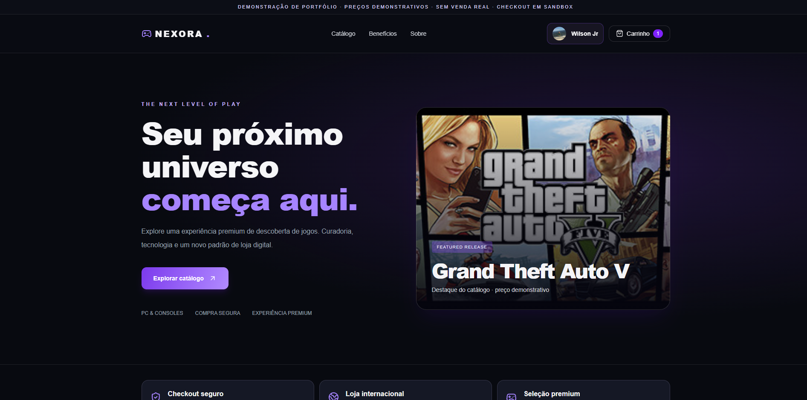

<div align="center">

# NEXORA GAMES

### Full-Stack Gaming E-Commerce Platform

A modern gaming storefront built with Next.js, TypeScript, Supabase, and Stripe.

[**Live Application**](https://nexora-games-zeta.vercel.app) · [**Source Code**](https://github.com/wilsonjr-create/NEXORA-GAMES)

</div>

---



## Overview

NEXORA GAMES is a full-stack e-commerce application designed to demonstrate modern web development practices, secure authentication, payment processing, and database integration.

The platform combines a responsive gaming storefront with server-side checkout validation, Stripe payment events, and authenticated purchase history.

The application is deployed on Vercel and its complete test payment flow has been validated.

> **Portfolio demonstration:** This application uses Stripe test mode. Prices are illustrative, no real payments are processed, and no commercial game keys are delivered.

## Key Features

**Storefront**
- Responsive dark-themed user interface
- Game catalog with search, filtering, and sorting
- Individual game detail pages
- Shopping cart and quantity management
- Server-side checkout price validation

**Authentication**
- Supabase Auth integration
- User authentication and session handling
- Protected account dashboard
- User-specific purchase history

**Payments and Orders**
- Stripe Checkout in test mode
- Server-side checkout session creation
- Signed Stripe webhook verification
- Payment status synchronization
- Order persistence in Supabase PostgreSQL
- Purchase history associated with authenticated users

## Technology Stack

| Layer | Technology |
| --- | --- |
| Framework | Next.js 15 |
| UI | React 19, TypeScript |
| Styling | Tailwind CSS 4 |
| Backend | Next.js Route Handlers |
| Authentication | Supabase Auth |
| Database | PostgreSQL via Supabase |
| Payments | Stripe Checkout and Webhooks |
| Icons | Lucide React, React Icons |
| Deployment | Vercel |
| Version Control | Git and GitHub |

## Architecture

```text
Browser / React
       |
       v
Next.js Application
       |
       +---- Supabase Auth
       |         |
       |         +---- Authenticated Sessions
       |
       +---- Checkout API
       |         |
       |         +---- Stripe Checkout (Test Mode)
       |                    |
       |                    v
       |              Stripe Webhook
       |                    |
       |                    v
       |              Supabase PostgreSQL
       |                    |
       +---- Account Dashboard
                         |
                         v
                  Purchase History
```

The checkout API validates the selected products on the server before creating a Stripe Checkout session.

Stripe sends payment events to the application's webhook endpoint. The webhook verifies the event signature and updates order records in PostgreSQL.

The account dashboard retrieves purchase history for the authenticated user.

## Project Structure

```text
src/
├── app/
│   ├── api/
│   │   ├── checkout/
│   │   └── webhooks/stripe/
│   ├── auth/callback/
│   ├── jogo/[id]/
│   ├── login/
│   ├── minha-conta/
│   └── success/
├── components/
├── contexts/
└── lib/

docs/
└── images/
    └── storefront.png

supabase/
└── schema.sql
```

## Local Development

### Requirements

- Node.js and npm
- Supabase project
- Stripe account configured for test mode

### Installation

```bash
git clone https://github.com/wilsonjr-create/NEXORA-GAMES.git
cd NEXORA-GAMES
npm install
cp .env.example .env.local
```

Configure the following environment variables:

```env
NEXT_PUBLIC_SUPABASE_URL=
NEXT_PUBLIC_SUPABASE_PUBLISHABLE_KEY=
SUPABASE_SERVICE_ROLE_KEY=
STRIPE_SECRET_KEY=
STRIPE_WEBHOOK_SECRET=
NEXT_PUBLIC_SITE_URL=http://localhost:3000
```

The Stripe webhook signing secret must match the environment receiving Stripe events.

### Start Development Server

```bash
npm run dev
```

Open http://localhost:3000.

### Production Build

```bash
npm run build
npm run start
```

## Security Considerations

- Authentication is managed through Supabase Auth.
- Database access is restricted using Row Level Security policies.
- Checkout prices are validated on the server.
- Stripe webhook signatures are verified before processing events.
- Privileged Supabase credentials are used only in server-side code.
- Environment variables containing secrets must never be committed to Git.

This application is a portfolio demonstration, not a production-ready commercial payment service.

## Deployment and Validation

**Hosting:** Vercel

**Application:** https://nexora-games-zeta.vercel.app

The following workflow has been validated in the deployed environment:

1. User authentication through Supabase.
2. Game selection and checkout initialization.
3. Successful Stripe test payment.
4. Stripe webhook processing.
5. Order persistence in Supabase PostgreSQL.
6. Approved order displayed in the authenticated account dashboard.

## Future Improvements

- Administrative inventory management
- Transactional email notifications
- Automated testing and CI workflows
- Additional account and order management features
- Commercial fulfillment integration, subject to licensing and business requirements

## Disclaimer

NEXORA GAMES is an independent educational and portfolio project.

It is not affiliated with or endorsed by any game publisher, platform owner, or digital storefront. Game names and artwork remain the property of their respective rights holders.

No real game purchases or activation-key deliveries are provided.

## Author

**Wilson Jr**

Full-Stack Developer

[GitHub Profile](https://github.com/wilsonjr-create)

---

<div align="center">

Built with Next.js, TypeScript, Supabase, and Stripe.

</div>
